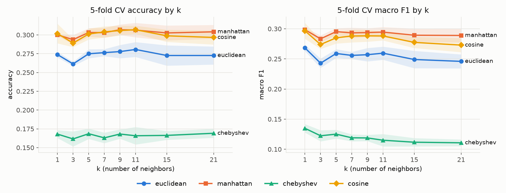
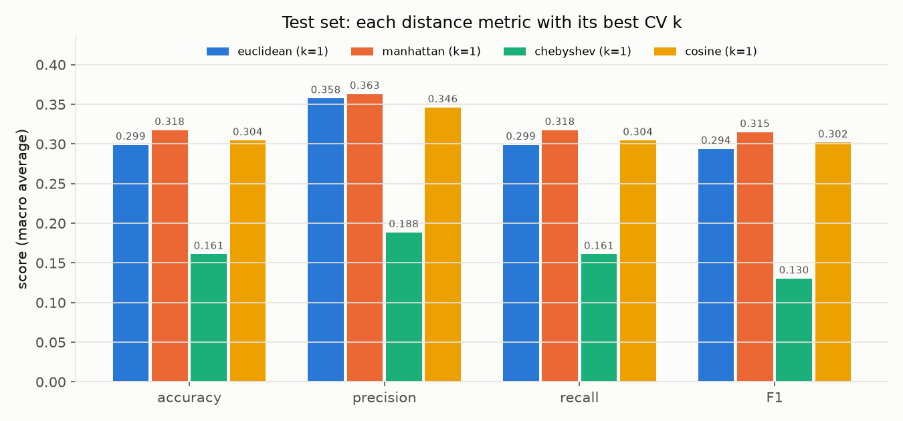
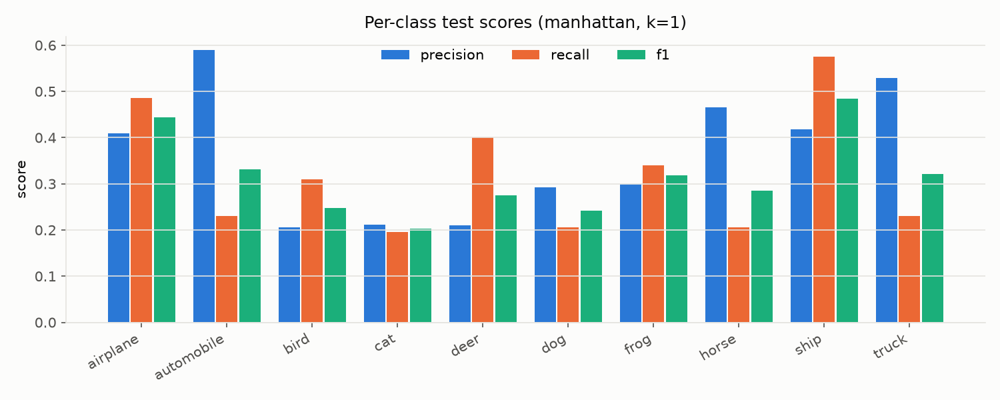
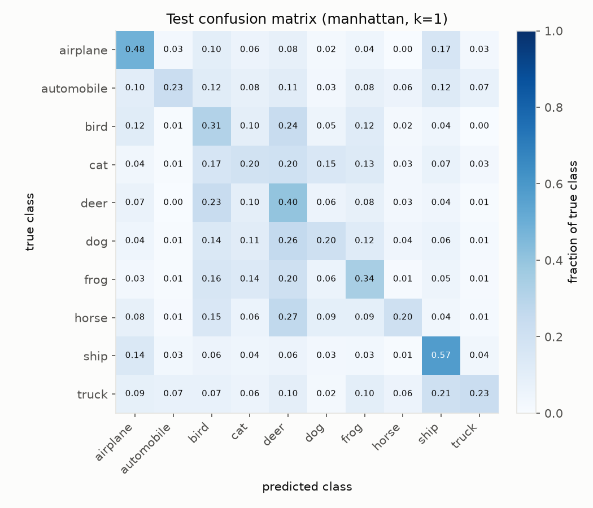

# CIFAR-10 K-최근접 이웃(KNN) 분류 실험

NumPy만 사용해 KNN 분류기, 계층적(stratified) 5-fold 교차검증, 평가 지표(Accuracy / Precision / Recall / F1)를 직접 구현하고,
**k 값**과 **거리 측정 방법**에 따라 CIFAR-10 분류 성능이 어떻게 달라지는지 비교했습니다.

## 1. 프로젝트 구조

```
.
├── knn.py               # KNN 구현, 5-fold CV, 평가 지표, 실험 실행
├── plot_results.py      # 결과 CSV → 그래프 생성
├── requirements.txt
└── outputs/
    ├── results.csv          # fold별 CV 결과 + 테스트 결과
    ├── cv_summary.csv       # (거리, k)별 5-fold 평균 ± 표준편차
    ├── per_class_test.csv   # 최종 모델의 클래스별 P/R/F1
    ├── confusion_matrix.csv # 최종 모델의 테스트 혼동 행렬
    ├── config.json          # 실험 설정 및 선택된 하이퍼파라미터
    └── figures/             # 보고서용 그래프
```

## 2. 실행 방법

```bash
python3 -m venv .venv
source .venv/bin/activate
pip install -r requirements.txt

python3 knn.py --download   # CIFAR-10 다운로드(약 170MB) 후 전체 실험 (작성자 노트북 기준 약 11분)
python3 plot_results.py     # outputs/figures/*.png 생성
```

빠른 동작 확인용:

```bash
python3 knn.py --download --max-train 1000 --max-test 200 --k-values 1 3 5
```

`data/` 폴더(원본 데이터셋)는 용량 때문에 `.gitignore`로 제외했습니다. `--download` 옵션이 공식 배포처에서 받아 MD5 체크섬을 검증합니다.

## 3. 실험 설정

| 항목 | 설정 |
|---|---|
| 데이터 | CIFAR-10 (10개 클래스, 32×32×3 컬러 이미지) |
| 학습/검증 데이터 | 학습 세트 50,000장 중 **클래스별 1,000장씩 10,000장** 계층 추출 |
| 테스트 데이터 | 테스트 세트 10,000장 중 **클래스별 200장씩 2,000장** 계층 추출 |
| 입력 특징 | 원본 픽셀 3,072차원(32×32×3), [0, 1]로 정규화 |
| k 값 | 1, 3, 5, 7, 9, 11, 15, 21 |
| 거리 측정 | Euclidean(L2), Manhattan(L1), Chebyshev(L∞), Cosine |
| 검증 | 계층적 5-fold 교차검증 (각 fold 8,000 학습 / 2,000 검증) |
| 평가 지표 | Accuracy, Macro Precision, Macro Recall, Macro F1 |
| 모델 선택 | CV 평균 **Macro F1** 최대 (동률이면 Accuracy, 그다음 작은 k) |
| 난수 시드 | 42 |

> 정확한 KNN은 모든 학습 샘플과의 거리를 계산해야 하므로, 특히 L1/L∞ 거리(행렬곱으로 계산 불가)는 50,000장 전체 사용 시 시간이 매우 오래 걸립니다. 그래서 클래스 균형을 유지한 10,000 / 2,000장 부분집합을 사용했습니다. `--max-train 0 --max-test 0` 옵션으로 전체 데이터 실험도 가능합니다.

**절차**: ① 10,000장의 학습 데이터로 모든 (거리, k) 조합을 5-fold CV로 평가 → ② CV 결과로 최적 조합을 선택 → ③ 10,000장 전체로 다시 학습한 뒤, 실험에 한 번도 쓰이지 않은 테스트 2,000장에서 최종 평가. 비교를 위해 각 거리 측정 방법도 자신의 최적 k로 테스트 세트에서 평가했습니다.

## 4. 구현 내용

### KNN (`KNearestNeighbors` 클래스)
- `fit`: 학습 데이터를 저장(lazy learning). Euclidean은 ‖x‖²를, Cosine은 정규화된 벡터를 미리 계산해 둡니다.
- 거리 계산
  - **Euclidean**: ‖q − x‖² = ‖q‖² + ‖x‖² − 2q·x 전개식으로 행렬곱 한 번에 계산 (제곱근은 순서를 바꾸지 않아 생략)
  - **Cosine**: 1 − (q·x)/(‖q‖‖x‖)
  - **Manhattan**: Σ|q − x|, **Chebyshev**: max|q − x| — 차이 텐서가 커서 학습 데이터를 청크 단위로 나눠 메모리를 제한
- `predict_many_k`: 거리 행렬을 **한 번만** 계산하고 `argpartition`으로 상위 max(k)개 이웃을 정렬해 두면, 모든 k에 대한 예측을 동시에 얻을 수 있습니다. 덕분에 k를 8개 실험해도 거리 계산 비용은 1번입니다.
- 다수결 투표로 예측하며, 동점이면 가장 작은 클래스 번호를 선택합니다(결정적 동작).

### 교차검증 / 지표
- `make_stratified_folds`: 클래스별로 섞은 뒤 5등분해, 모든 fold의 클래스 비율이 같도록 구성
- `classification_metrics`: 혼동 행렬로부터 Accuracy와 클래스별 Precision/Recall/F1을 구한 뒤 **macro 평균**(10개 클래스 단순 평균)

## 5. 실험 결과

### 5.1 k 값과 거리 측정 방법에 따른 5-fold CV 결과



*(음영: fold 간 ±1 표준편차)*

**CV 평균 Accuracy**

| 거리 \ k | 1 | 3 | 5 | 7 | 9 | 11 | 15 | 21 |
|---|---|---|---|---|---|---|---|---|
| Euclidean | 0.2738 | 0.2614 | 0.2749 | 0.2764 | 0.2778 | **0.2806** | 0.2726 | 0.2726 |
| Manhattan | 0.3001 | 0.2937 | 0.3032 | 0.3030 | **0.3069** | 0.3064 | 0.3026 | 0.3041 |
| Chebyshev | 0.1680 | 0.1616 | 0.1685 | 0.1630 | 0.1681 | 0.1658 | 0.1663 | **0.1691** |
| Cosine | 0.3018 | 0.2891 | 0.3012 | 0.3040 | 0.3058 | **0.3069** | 0.2988 | 0.2966 |

**CV 평균 Macro F1**

| 거리 \ k | 1 | 3 | 5 | 7 | 9 | 11 | 15 | 21 |
|---|---|---|---|---|---|---|---|---|
| Euclidean | **0.2683** | 0.2429 | 0.2590 | 0.2558 | 0.2570 | 0.2595 | 0.2490 | 0.2459 |
| Manhattan | **0.2985** | 0.2833 | 0.2953 | 0.2932 | 0.2937 | 0.2945 | 0.2893 | 0.2889 |
| Chebyshev | **0.1348** | 0.1224 | 0.1251 | 0.1190 | 0.1188 | 0.1150 | 0.1117 | 0.1107 |
| Cosine | **0.2966** | 0.2739 | 0.2850 | 0.2880 | 0.2883 | 0.2881 | 0.2774 | 0.2729 |

**거리별 최적 설정(k=1)의 CV 4개 지표 (평균 ± 표준편차)**

| 거리 | k | Accuracy | Precision | Recall | F1 |
|---|---|---|---|---|---|
| Euclidean | 1 | 0.2738 ± 0.0038 | 0.3231 ± 0.0081 | 0.2738 ± 0.0038 | 0.2683 ± 0.0055 |
| **Manhattan** | **1** | **0.3001 ± 0.0012** | **0.3434 ± 0.0051** | **0.3001 ± 0.0012** | **0.2985 ± 0.0028** |
| Chebyshev | 1 | 0.1680 ± 0.0052 | 0.1868 ± 0.0103 | 0.1680 ± 0.0052 | 0.1348 ± 0.0070 |
| Cosine | 1 | 0.3018 ± 0.0130 | 0.3396 ± 0.0076 | 0.3018 ± 0.0130 | 0.2966 ± 0.0132 |

전체 32개 조합의 4개 지표와 표준편차는 [`outputs/cv_summary.csv`](outputs/cv_summary.csv)에 있습니다.

### 5.2 테스트 세트 최종 결과

CV로 선택된 최적 모델은 **Manhattan 거리, k = 1** 입니다.

| 거리 (최적 k) | Accuracy | Precision | Recall | F1 |
|---|---|---|---|---|
| Euclidean (k=1) | 0.2990 | 0.3576 | 0.2990 | 0.2938 |
| **Manhattan (k=1) ★** | **0.3175** | **0.3630** | **0.3175** | **0.3149** |
| Chebyshev (k=1) | 0.1610 | 0.1884 | 0.1610 | 0.1302 |
| Cosine (k=1) | 0.3045 | 0.3460 | 0.3045 | 0.3018 |



### 5.3 최종 모델의 클래스별 성능과 혼동 행렬

| 클래스 | Precision | Recall | F1 |
|---|---|---|---|
| airplane | 0.409 | 0.485 | 0.444 |
| automobile | 0.590 | 0.230 | 0.331 |
| bird | 0.205 | 0.310 | 0.247 |
| cat | 0.211 | 0.195 | 0.203 |
| deer | 0.210 | 0.400 | 0.275 |
| dog | 0.293 | 0.205 | 0.241 |
| frog | 0.300 | 0.340 | 0.319 |
| horse | 0.466 | 0.205 | 0.285 |
| ship | 0.418 | 0.575 | 0.484 |
| truck | 0.529 | 0.230 | 0.321 |





## 6. 결과 비교 및 분석

### 6.1 거리 측정 방법 비교: Manhattan ≈ Cosine > Euclidean ≫ Chebyshev
- **Manhattan(L1)이 가장 좋았습니다** (테스트 Accuracy 31.75%, F1 0.315). 무작위 추측(10%)의 약 3배입니다.
- **Euclidean(L2)은 L1보다 약 2.5~3%p 낮습니다.** L2는 픽셀 차이를 제곱하기 때문에, 배경이나 조명 차이처럼 일부 픽셀에서 크게 벌어지는 차이가 거리를 지배합니다. L1은 모든 픽셀 차이를 선형으로 합산해 이런 큰 차이에 덜 민감합니다. 이 차이는 fold 간 표준편차(약 0.005)보다 훨씬 커서 의미 있는 차이로 볼 수 있습니다.
- **Cosine은 L1과 거의 동등**합니다(CV F1 0.2966 vs 0.2985, 표준편차 범위 안). 코사인 거리는 벡터 크기를 무시하므로 같은 장면이 밝거나 어둡게 찍혀도 가깝게 판단합니다. 같은 행렬곱 기반인 Euclidean보다 3%p 가량 높은 이유가 바로 이 **밝기(스케일) 불변성**입니다.
- **Chebyshev(L∞)는 16% 수준으로 매우 나쁩니다.** 3,072개 픽셀 중 차이가 가장 큰 *단 하나의 픽셀*만으로 거리를 정하므로, 이미지 전체의 유사성을 거의 반영하지 못합니다. 고차원 이미지 데이터에는 부적합한 거리입니다.
- **계산 비용**: Euclidean/Cosine은 행렬곱으로 계산되어 fold당 약 0.3초, Manhattan/Chebyshev는 원소별 차이를 직접 계산해야 해서 fold당 약 46~57초로 **약 200배** 느렸습니다. 성능만 보면 L1이 좋지만, 속도까지 고려하면 Cosine이 좋은 절충안입니다.

### 6.2 k 값의 영향: Accuracy와 F1이 다른 k를 선호
- **Accuracy**는 k = 9~11에서 가장 높았지만(Manhattan 0.3069), **Macro F1**은 모든 거리에서 **k = 1**이 가장 높았습니다. k가 커질수록 Precision은 올라가지만(Euclidean 0.32 → 0.40) F1은 떨어집니다.
- 이유: k가 크면 다수결이 **특정 클래스(deer, bird, frog 등 녹색/갈색 배경의 클래스)로 쏠리는** 경향이 생깁니다. 이 클래스들은 많이 예측되어 Recall이 오르지만, 거의 예측되지 않는 클래스(automobile, truck 등)는 Recall이 크게 떨어집니다. 거의 예측되지 않는 클래스는 맞힐 때만 예측되므로 Precision이 높아져 macro Precision을 끌어올리지만, Recall 불균형 때문에 F1은 감소합니다.
- **k = 3에서 성능이 뚜렷이 하락**합니다. 이웃 3개가 모두 다른 클래스(1-1-1)인 경우가 많은데, 이때 동점 처리 규칙(작은 클래스 번호 선택)이 사실상 임의 선택이 되어 가장 가까운 이웃의 정보를 버리게 됩니다. k = 1은 이런 동점이 없습니다.
- 클래스 균형을 함께 고려하는 Macro F1을 기준으로 모델을 골랐기 때문에 k = 1이 선택되었습니다. Accuracy만 본다면 k = 9~11이 근소하게 낫지만 차이(약 0.7%p)는 fold 간 표준편차 수준입니다.

### 6.3 Precision > Recall 패턴, Recall = Accuracy
- 실험에서 **macro Recall은 항상 Accuracy와 같습니다.** 테스트/검증 세트가 클래스별로 같은 개수를 갖도록 계층 추출했기 때문에, 클래스별 Recall의 평균이 전체 정답률과 수학적으로 일치합니다.
- **Precision이 Recall보다 항상 높은 것**은 위에서 설명한 예측 쏠림 때문입니다. 예: automobile은 Precision 0.59 / Recall 0.23, deer는 Precision 0.21 / Recall 0.40.

### 6.4 혼동 행렬 분석: KNN은 "의미"가 아니라 "색과 배경"을 본다
- 가장 잘 맞힌 클래스는 **ship(57.5%)과 airplane(48.5%)** 으로, 둘 다 하늘·바다의 **파란 배경**이라는 뚜렷한 색 패턴이 있습니다. 동시에 airplane → ship(17%), truck → ship(21%) 같은 오분류가 많아, 같은 배경색이면 다른 물체라도 가깝게 판단함을 알 수 있습니다.
- 동물 클래스(cat, dog, horse, bird, deer)는 서로 크게 섞이며, 특히 **deer와 bird로 예측되는 경우가 많습니다**(horse의 27%, dog의 26%가 deer로 예측). 녹색·갈색의 자연 배경이 비슷하기 때문입니다.
- cat(F1 0.20)과 dog(0.24)가 가장 어려운 클래스였습니다.
- 즉, 원본 픽셀 공간의 거리는 물체의 형태나 의미보다 **전체 색 분포와 배경**에 좌우됩니다. 이것이 픽셀 기반 KNN 성능이 30% 수준에 머무는 근본적인 원인입니다.

## 7. 결론

| 항목 | 결과 |
|---|---|
| 최적 거리 측정 | **Manhattan(L1)** (Cosine과 거의 동등, Euclidean보다 ~3%p 우수) |
| 최적 k (Macro F1 기준) | **k = 1** (Accuracy 기준으로는 k = 9~11) |
| 최종 테스트 성능 | Accuracy **31.75%**, Precision 0.363, Recall 0.318, F1 **0.315** |
| 부적합한 거리 | Chebyshev(L∞) — 16%, 고차원 이미지에서 정보 대부분을 버림 |

KNN은 학습이 필요 없고 구현이 단순하지만, CIFAR-10처럼 고차원 자연 이미지에서는 (1) 픽셀 거리가 의미적 유사성을 잘 반영하지 못하고, (2) 예측 시 모든 학습 데이터와의 거리를 계산해야 하므로 느리다는 한계가 분명했습니다.

### 한계 및 개선 방향
- 계산 시간 때문에 학습 10,000장 / 테스트 2,000장의 부분집합을 사용했습니다. 학습 데이터를 50,000장 전부 쓰면 이웃 후보가 늘어나 정확도가 몇 %p 더 오를 것으로 예상됩니다.
- **특징 추출**: 원본 픽셀 대신 HOG, 색 히스토그램, 또는 사전학습 CNN 특징을 사용하면 KNN 성능이 크게 오릅니다.
- **전처리**: 채널별 평균/표준편차 정규화, PCA 차원 축소(속도와 노이즈 제거 모두 개선).
- **투표 방식**: 거리 가중 투표(가까운 이웃에 더 큰 가중치)를 쓰면 k = 3에서의 동점 문제와 큰 k에서의 클래스 쏠림을 완화할 수 있습니다.
